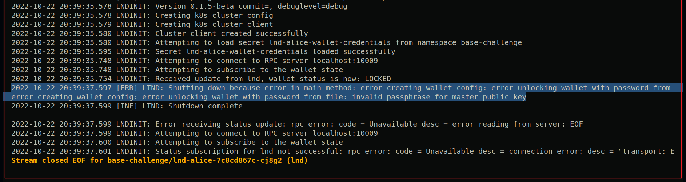
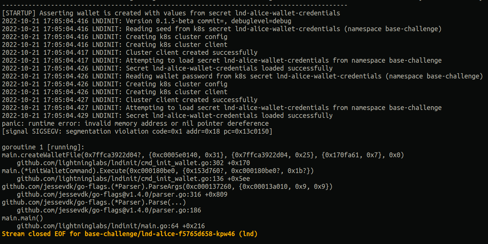

# Lightning Labs Code Challenge
Reference -> https://docs.google.com/document/d/1I83EFLwSFiSo_3WfLPbLMLjN363kw2cPKa23UTOyU6M/edit?pli=1#

This Repository contains all required pieces to setup the following:

1. bitcoind node
2. lnd-alice node
3. lnd-bob node

## Requirements
for running this stack you will need a fresh version of:

- docker
- minikube
- kubectl
- helm

## Steps
- if your minikube instance is not running, start it now `minikube start` 
- go to `/SECRETS/bitcoin.conf` and set the RPC password and user name of your choice
- go to `/SECRETS/lnd.conf` and set the RPC password and user name of your choice
- run `bootstrap.sh`
- after youre done, just run `cleanup.sh`

## In Progress
- fixing lndinit config such that it stores the RPC passwords as k8s secrets.
- creating the program that performs the following actions:
  - generate alice new on-chain address
  - mine few blocks using alice address to receive mining rewards
  - use mining rewards to open channels to bob
  - make some payments thru said channels to bob and back to alice
- gitops advanced challenge

## known problems
- depending on your minikube storage configuration, when running `cleanup.sh` and attempting `bootstrap.sh` again, you will find this error... it can be fixed by deleting the lnd volumes inside the minikube host.

- by switching `securityContext.enabled` in the `lnd` chart, the `lndinit` process panics with a nil pointer deref

